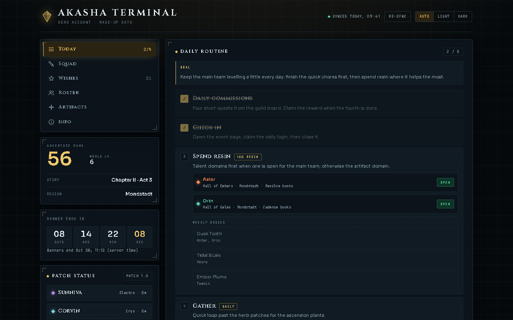
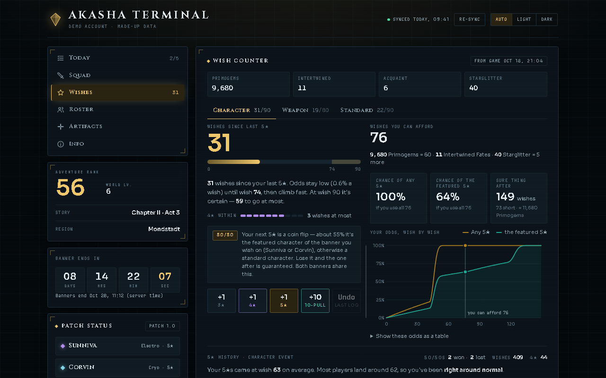
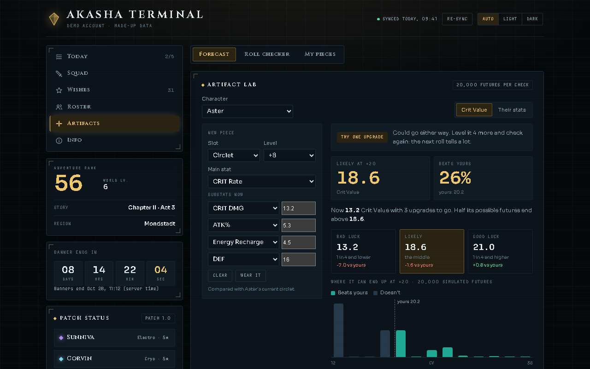

# Akasha Terminal

A night-and-gold dashboard for a Genshin Impact account: daily routine, squad plans, a Wish Counter with odds, a roster with materials, and an Artifact Lab that forecasts upgrades.

*The screenshots and the included `data.js` use invented example data: a made-up player, made-up characters and made-up wish numbers.*

## What it does

- **Today:** a daily checklist you tick off, a resin step that shows which talent domains are open today, and a countdown to the banner's end.
- **Squad and Roster:** your priority team, bench and reference cards with weapon, artifact and energy-recharge targets, plus the ascension and talent materials each character needs.
- **Wishes:** a Wish Counter with pity, the 50/50 state, a "wishes you can afford" estimate and a wish-by-wish odds chart. You can log wishes by hand, or import them from the game (see below).
- **Artifacts:** an Artifact Lab that simulates 20,000 possible futures for a piece you are levelling, a roll checker, and a place for your saved pieces.
- Light, dark or automatic theme. Your ticks and saved pieces are kept in the browser's local storage on your own PC.

All the content comes from one file, `data.js`. The page (`index.html`, `script.js`, `style.css`) never has content written into it, so you update the dashboard by editing `data.js` only.

## Run it

It is a plain web page with no server and nothing to install.

1. Download or clone this folder.
2. Open `index.html` in a browser (double-click it).

It loads two fonts from Google Fonts; without internet it falls back to your system fonts. The folder `prototype/` holds the early prototype pages (wish counter and artifact lab) this grew from.

To use your own data, edit `data.js` (the player block, squad, farming targets, roster and so on). Everything in it is example content for now.

## Optional: import your wishes from the game (Windows)

`sync-wishes.ps1` is a PowerShell script that reads your wish history the way sites like paimon.moe do:

1. In Genshin Impact, open **Wish > History** once. The game then caches a temporary link to the wish-history service.
2. Run `sync-wishes.ps1` (right-click, *Run with PowerShell*). It finds that link in the game's local web cache and asks HoYoverse's server for your wishes.
3. It merges new wishes into `wish-archive.json` and writes `wishes-sync.js`, which the page loads.

Privacy notes:

- The link carries an **authkey**, a temporary pass (about a day) that lets whoever holds it read your wish history. The script uses it only in memory: it is never printed, logged or saved, and error messages have it masked. Do not share the link.
- `wish-archive.json` holds your wish records (no UID, no key). It is listed in `.gitignore` so it does not end up in a public repository. After a sync, `wishes-sync.js` also holds your wish numbers, so do not commit it either.
- The only network request the script makes is to HoYoverse's own wish-history service, to read your own history. The dashboard page itself sends nothing anywhere.

## Files

`index.html`, `script.js` and `style.css` are the page; `data.js` is the content; `wishes-sync.js` is a placeholder that the sync script overwrites; `sync-wishes.ps1` is the optional importer; `prototype/` has the early prototypes.

Unofficial fan-made project, not affiliated with or endorsed by HoYoverse. Genshin Impact and related names belong to their owners.

## Licence

MIT, see [LICENSE](LICENSE).

More projects: https://github.com/Shamilimanuel
